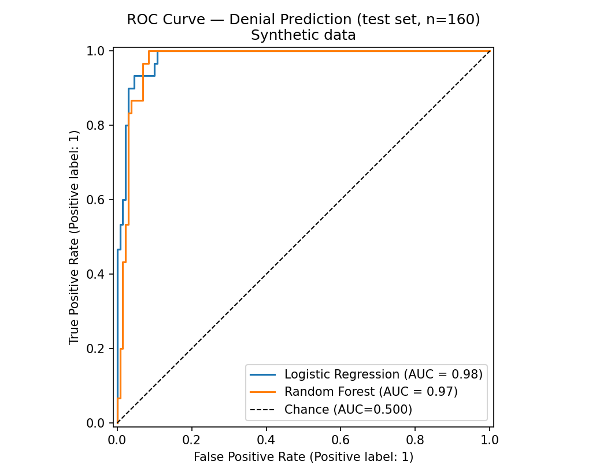
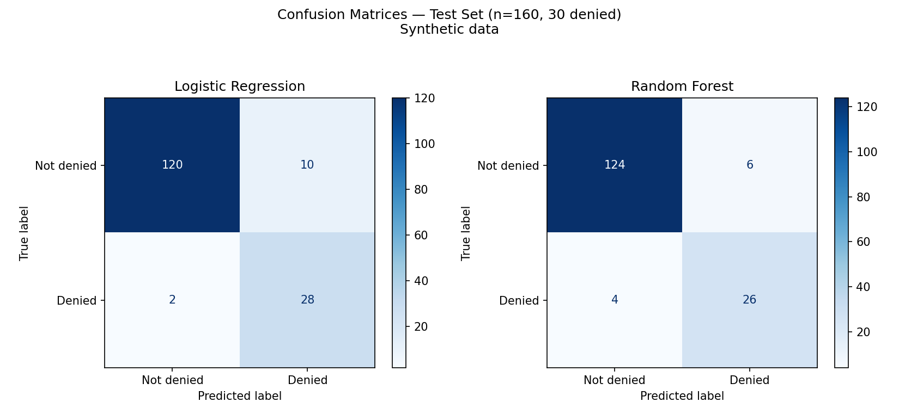
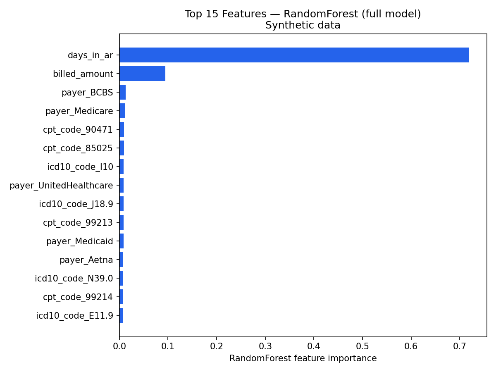
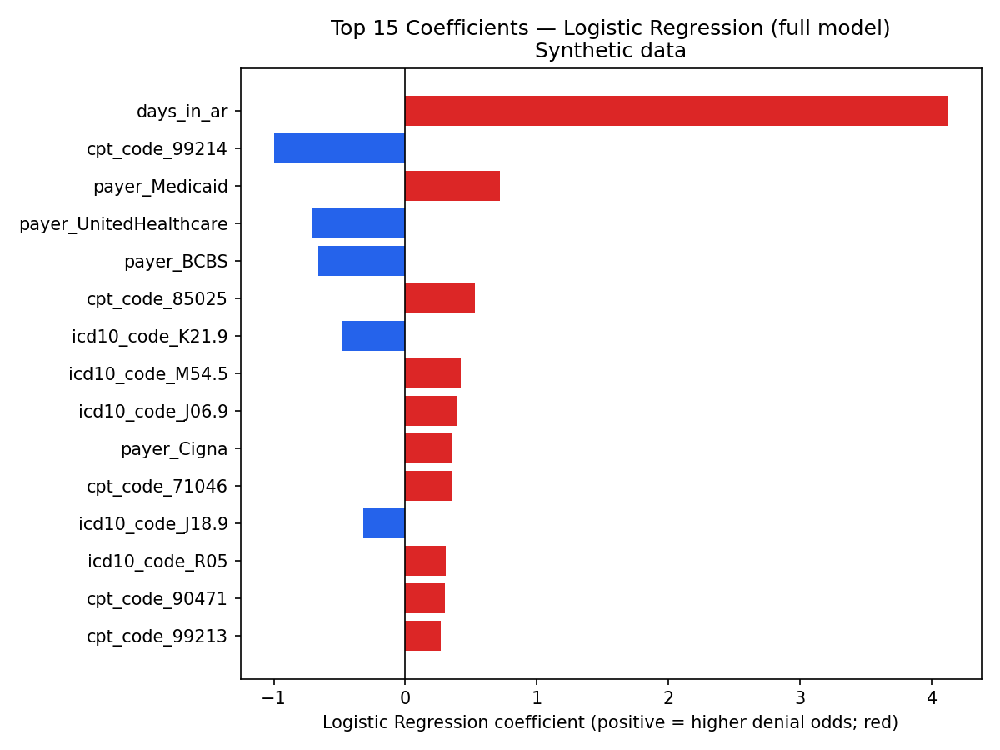
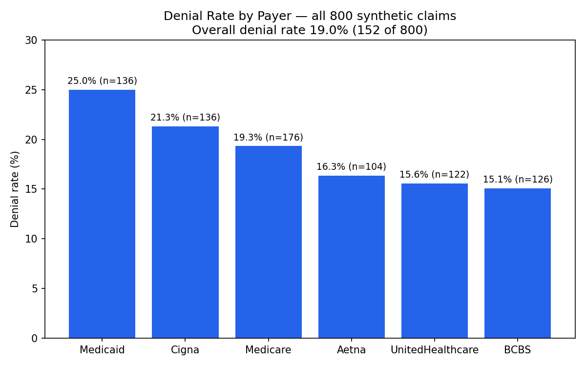

# Denial Prediction — Synthetic Medical Billing Claims

> **⚠️ SYNTHETIC DATA ONLY.** Every claim in this project is invented
> (seeded generator, seed 42 — the same file Project 1 uses). There are
> no real patients, no real claims, no real payer data, and no protected
> health information.
>
> The author has **no prior RCM / medical billing work experience** —
> this project was built to learn denial prediction on synthetic data.
> Nothing here claims otherwise, and nothing here should be used to
> make decisions about real claims.

A portfolio project by **Muhammad Talha Zahid** — BS Computer Science
(Allama Iqbal Open University, 2020–2024); Operations Analyst, Honda
Downtown Rawalpindi (May 2025–Aug 2026; Power BI, DAX, Power Query, SQL,
Excel); freelance Data Scientist & Analyst on Fiverr since Aug 2023
(180+ projects). Goal: Reporting Analyst in medical billing / RCM, then
Data Scientist.

**Data source:** this project reuses the exact dataset from
[Project 1 — RCM Reporting Dashboard](../rcm-reporting-dashboard/)
(`data/claims_raw.csv`, 800 synthetic claims, seed 42). No data was
regenerated, so the two projects agree: 800 claims, billed
$1,084,894.45, paid $616,318.86, **152 denied (19.0%)** — Paid 535 ·
Denied 152 · Pending 113.

## The honest headline — read this first

The models below look strong (ROC-AUC 0.97–0.98), but that strength
comes almost entirely from **one feature: `days_in_ar`**. Denied claims
sit in AR far longer than paid ones (mean 90.5 days vs 29.5 days), so
`days_in_ar` is really a *consequence* of being denied, not information
available when a claim is first submitted. RandomForest gives it 0.72 of
all feature importance; Logistic Regression gives it a coefficient of
+4.12, dwarfing every other feature.

When the same models are retrained **without** `days_in_ar` — using only
what is known at submission (payer, CPT, ICD-10, billed amount) — they
are barely better than chance (ROC-AUC 0.54). In this synthetic data,
those four fields carry almost no denial signal: the generator assigned
denials roughly independently of them (denial rates by payer range only
15.1%–25.0%, by CPT 14.3%–20.9%, by ICD-10 14.1%–26.4%).

So the truthful summary is:

- **As an "already-ageing claim" flagger** (spot claims sitting unpaid
  long after submission), the model works well.
- **As an at-submission denial predictor**, it does not — on this data.
  A real version would need genuinely predictive fields the synthetic
  set does not have (e.g. prior-authorization status, eligibility-check
  result, coding flags, payer-specific rules).

Both versions are reported below, with the full model first (as briefed)
and the no-`days_in_ar` model alongside it, so nobody has to take the
headline numbers at face value.

## Results (from the actual test run — no invented numbers)

Split: stratified 80/20, `random_state=42` → **train 640** (122 denied,
19.1%), **test 160** (30 denied, 18.8%). 640 + 160 = 800; 122 + 30 = 152. ✓

### Full models — features: payer, CPT, ICD-10, billed_amount, days_in_ar

| Model | Accuracy | Precision | Recall | F1 | ROC-AUC | Confusion matrix (TN / FP / FN / TP) |
|---|---|---|---|---|---|---|
| Logistic Regression | 0.925 | 0.737 | 0.933 | 0.824 | 0.982 | 120 / 10 / 2 / 28 |
| RandomForest (300 trees) | 0.938 | 0.813 | 0.867 | 0.839 | 0.973 | 124 / 6 / 4 / 26 |

RandomForest has the better F1 and precision; Logistic Regression has
the better recall (it misses only 2 of 30 denied claims, at the cost of
10 false alarms). With only 30 denied claims in the test set, the gap
between the two models is small — a couple of claims either way.

### Honest at-submission models — same models, WITHOUT days_in_ar

| Model | Accuracy | Precision | Recall | F1 | ROC-AUC | Confusion matrix (TN / FP / FN / TP) |
|---|---|---|---|---|---|---|
| Logistic Regression | 0.575 | 0.194 | 0.400 | 0.261 | 0.544 | 80 / 50 / 18 / 12 |
| RandomForest (300 trees) | 0.756 | 0.091 | 0.033 | 0.049 | 0.535 | 120 / 10 / 29 / 1 |

ROC-AUC ≈ 0.54 for both is essentially chance (0.50). The RandomForest
here finds only 1 of 30 denied claims. This is the finding, not a
failure of the code: the submission-time fields in this synthetic data
do not predict denial.

## Charts (matplotlib, from the actual run)

### ROC curve — both full models, test set



### Confusion matrices — both full models, test set



### Feature importance — RandomForest (full model)



`days_in_ar` = 0.7194 of total importance; `billed_amount` = 0.0945;
every payer / CPT / ICD-10 one-hot feature is ≤ 0.0132.

### Logistic Regression coefficients (full model)



`days_in_ar` +4.12 dominates. Next largest: CPT 99214 −1.00,
Medicaid +0.72, UnitedHealthcare −0.70, BCBS −0.66 — all small by
comparison, and on a test set of 30 denials they should not be
over-read as real payer effects.

### Denial rate by payer — all 800 claims



Medicaid 25.0% (n=136), Cigna 21.3% (n=136), Medicare 19.3% (n=176),
Aetna 16.3% (n=104), UnitedHealthcare 15.6% (n=122), BCBS 15.1%
(n=126). Overall 19.0%.

## Top features (full models, test run)

RandomForest top 10 (importance):

| Feature | Importance |
|---|---|
| days_in_ar | 0.7194 |
| billed_amount | 0.0945 |
| payer_BCBS | 0.0132 |
| payer_Medicare | 0.0111 |
| cpt_code_90471 | 0.0098 |
| cpt_code_85025 | 0.0095 |
| icd10_code_I10 | 0.0091 |
| payer_UnitedHealthcare | 0.0089 |
| icd10_code_J18.9 | 0.0089 |
| cpt_code_99213 | 0.0087 |

Logistic Regression top 10 coefficients (by absolute value; positive =
higher denial odds):

| Feature | Coefficient |
|---|---|
| days_in_ar | +4.1197 |
| cpt_code_99214 | −0.9966 |
| payer_Medicaid | +0.7190 |
| payer_UnitedHealthcare | −0.7037 |
| payer_BCBS | −0.6625 |
| cpt_code_85025 | +0.5313 |
| icd10_code_K21.9 | −0.4784 |
| icd10_code_M54.5 | +0.4181 |
| icd10_code_J06.9 | +0.3887 |
| payer_Cigna | +0.3601 |

## Features and leakage

Target: `denied = 1` if `status == "Denied"`, else 0. Pending claims
count as 0 — they are not denied yet, which is a modelling choice worth
knowing: the model predicts "denied" vs "not denied (paid or still
pending)".

Features used:

| Feature | Type | Why it is allowed |
|---|---|---|
| payer | categorical (one-hot) | Known at submission |
| cpt_code | categorical (one-hot, treated as a code, not a number) | Known at submission |
| billed_amount | numeric (scaled for Logistic Regression) | Known at submission |
| icd10_code | categorical (one-hot) | Known at submission |
| days_in_ar | numeric | Known only *after* the claim has aged — see the headline warning above. Included because the brief asked for it; the no-`days_in_ar` variant shows what happens without it. |

Excluded on purpose (leakage — checked by an assertion in
`src/train.py` and re-checked on the loaded pipelines in
`src/evaluate.py`):

| Excluded | Why |
|---|---|
| paid_amount | $0 for every denied claim — it *is* the outcome in disguise |
| denial_reason | Only exists after a denial has happened |
| status | This is the target |
| claim_id, patient_id | Identifiers, not predictors |
| service_date | Not used — no denial signal worth modelling, and it invites spurious time fits |

Both models are scikit-learn `Pipeline`s (one-hot encoding +
`StandardScaler` for Logistic Regression; RandomForest needs no
scaling), with `class_weight="balanced"` because only 19% of claims
are denied. Logistic Regression: `max_iter=1000`. RandomForest:
`n_estimators=300`, `random_state=42`.

## How to run

```bash
pip install -r requirements.txt   # pandas, numpy, scikit-learn, matplotlib, joblib
python src/run.py                 # prepare -> train -> evaluate, end to end
# or step by step:
python src/prepare.py             # load data, show the stratified 80/20 split
python src/train.py               # train both models (+ no-days_in_ar variants), save to models/
python src/evaluate.py            # print metrics, write screenshots/*.png
```

Environment used for the run reported here: Python 3.12, pandas 2.1.4,
scikit-learn 1.9.1, matplotlib 3.6.3. Note: plain
`pip install --user scikit-learn` failed in this sandbox (PEP 668,
externally-managed environment); scikit-learn 1.9.1 installed with
`pip install --user --break-system-packages scikit-learn`. On a normal
machine or venv, `pip install -r requirements.txt` is enough.

## Project structure

```
denial-prediction/
├── README.md
├── requirements.txt
├── src/
│   ├── prepare.py    load Project 1 CSV, target, leakage-safe features, stratified split
│   ├── train.py      Logistic Regression + RandomForest Pipelines (+ no-days_in_ar variants)
│   ├── evaluate.py   test metrics, feature importance, all charts
│   └── run.py        prepare -> train -> evaluate in one command
├── models/
│   ├── logistic_regression.joblib / random_forest.joblib
│   ├── logistic_regression_no_days_in_ar.joblib / random_forest_no_days_in_ar.joblib
│   └── metrics.json  every metric above, as produced by the run
└── screenshots/
    ├── roc_curve.png
    ├── confusion_matrix.png
    ├── feature_importance.png
    ├── lr_coefficients.png
    └── denial_rate_by_payer.png
```

## Verification (test run, 17 Nov 2026)

- End-to-end run (`python src/run.py`): prepare → train → evaluate,
  all three steps completed with no errors.
- Split: train 640 + test 160 = 800; denied train 122 + test 30 = 152. ✓
- KPIs re-checked against the source CSV in `prepare.py`: billed
  $1,084,894.45, paid $616,318.86 — identical to Project 1. ✓
- Leakage check: `train.py` asserts no forbidden column is in the
  feature list; `evaluate.py` re-checks the feature names stored in
  each saved pipeline (`paid_amount`, `denial_reason`, `status`,
  `claim_id`, `patient_id` all absent). ✓
- Charts: all five PNGs regenerated by `evaluate.py` and visually
  checked (ROC legend, confusion-matrix labels, feature-importance
  bars all render correctly; two layout fixes applied during the check).

## What was NOT tested

- **GradientBoosting:** the brief asked for RandomForest *or*
  GradientBoosting — RandomForest was used; GradientBoosting was not tried.
- **Hyperparameter tuning / cross-validation:** single stratified
  80/20 split only, no grid search, no k-fold CV. With 800 rows and 30
  denied claims in the test set, the metrics above are noisy — treat
  differences of a few points between models as noise.
- **Real data:** everything is synthetic. Performance on real claims
  would differ, and the at-submission result (AUC ≈ 0.54) is a property
  of this synthetic generator, not of real RCM data.
- **A live deployment:** the `.joblib` files are saved models for
  inspection, not a served API.
